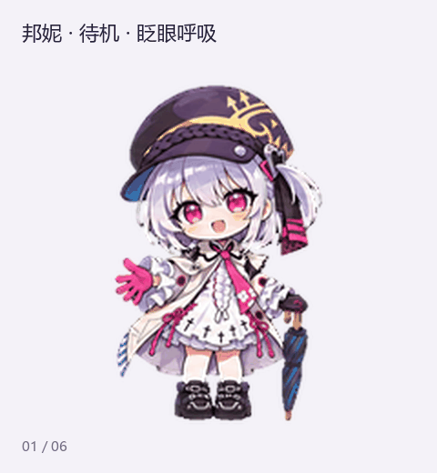

# 芬妮与邦妮 Q 版桌宠

## 移植到其他 Agent

图片素材完整。另提供 **146 张独立透明 PNG**，无需重新绘制或手动拆图：

- [下载逐帧 PNG 包](portable-frames.zip)（在文件页点 **Download raw file**，或下载整个仓库后解压）。
- [DeepSeek Harness / Claude Code 移植说明](PORTING.md)。
- [动作坐标与逐帧时长](animation-map.json) · [无损导出工具](export_frames.py)。

每套 57 个动作帧 + 16 个视线帧，单帧透明画布 192 × 208。素材和工具可独立使用；宿主仍需接入自己的事件与播放器。本包未宣称已安装或实测完整 DeepSeek Harness / Claude Code 插件。

芬妮与邦妮的两套 Q 版侦探桌宠素材。每只包含 **9 类标准动作、16 个视线方向，共 73 帧**，附完整动画和单动作预览。

| 芬妮 | 邦妮 |
| --- | --- |
|  |  |

芬妮是金发蓝瞳、戴白帽的侦探；思考与复查动作使用放大镜寻找线索。邦妮是银发粉瞳、戴深色帽的侦探；工作动作查阅案卷，跳跃与环视时不持伞。邦妮两只手套构造相同：**掌心与指腹为品红色，手背与指节外侧为黑色**。

## 下载与使用

| 角色 | 最终精灵表 | 完整视频 | 环视预览 |
| --- | --- | --- | --- |
| 芬妮 | [PNG](pets__fenny__spritesheet.png) | [MP4](pets__fenny__all-actions.mp4) | [GIF](pets__fenny__look-loop.gif) |
| 邦妮 | [PNG](pets__bonnie__spritesheet.png) | [MP4](pets__bonnie__all-actions.mp4) | [GIF](pets__bonnie__look-loop.gif) |

可直接打开 GIF 或 MP4 查看成品。在支持 Pets v2 图集的流程中，使用对应的精灵表 PNG；运行角色动画需要支持该格式的客户端。

## 文件命名

仓库使用平铺文件名，所有文件均位于根目录。原路径中的 `/` 替换为 `__`，例如 `pets/fenny/spritesheet.png` 对应 `pets__fenny__spritesheet.png`。以 `pets__fenny__` 和 `pets__bonnie__` 区分两位角色。

- `all-actions.gif` / `all-actions.mp4` 后缀：9 类标准动作的连续预览。
- `states__动作名.gif` 后缀：各动作独立循环 GIF。
- `idle-jump-idle.gif` 后缀：待机、跳跃、回到待机的衔接预览。
- `look-loop.gif` 后缀：16 个视线方向的有序循环。
- `contact-sheet.png` / `direction-sheet.png` 后缀：动作帧和视线方向总览。
- `timeline.json` 后缀：连续预览的时间与帧索引，单位为毫秒。

## 图集规格

透明 PNG 精灵表为 **1536 × 2288** 像素，8 列 × 11 行，每格 192 × 208 像素。前九行依次为待机、向右移动、向左移动、招手、跳跃、失落、等待回应、工作／思考、复查；有效帧数为 6、8、8、4、5、8、6、6、6。行末未使用格子保持透明。

最后两行包含 16 个方向，从上方开始按屏幕方向顺时针每 22.5° 排列：000° 向上、090° 向右、180° 向下、270° 向左。

[manifest.json](manifest.json) 记录当前文件名、原相对路径、文件大小及 SHA-256。素材沿用确认的 Q 版画风，图像由 ImageGen 参考图生成并经分帧、透明边缘与动作检查后整理。
